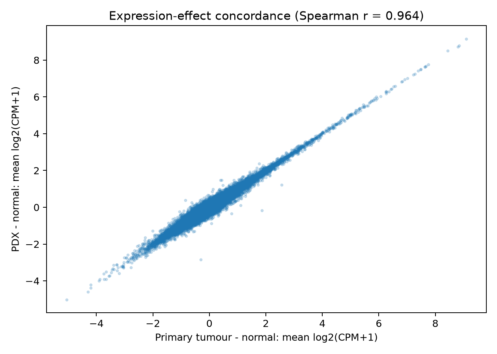
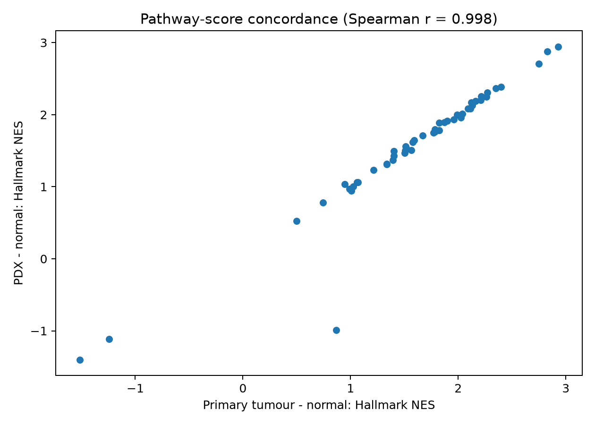

# Transcriptional comparison of colorectal SRCC tumours and PDX samples

An independent computational reanalysis of **GSE279979**, comparing primary colorectal signet-ring cell carcinoma (SRCC), patient-derived xenografts (PDX), and adjacent normal tissue. The six deposited samples show strong concordance of tumour-associated expression changes and pathway enrichment.

## Findings

The complete public-count-table rerun retained 23,796 genes and reproduced the gene-effect result:

| Measurement | Result |
| --- | --- |
| Tumour–normal versus PDX–normal gene-effect concordance | Spearman r = **0.96434** |
| Hallmark enrichment-score concordance | Spearman r = **0.99760** |
| Jointly significant Hallmark sets, with matching enrichment direction | **35** at FDR < 0.05 in both contrasts |
| PDX similarity to primary-tumour expression centroid | Spearman r = **0.98684** and **0.98669** |
| Median absolute direct PDX–tumour expression difference | **0.08383** mean log2(CPM+1) units |





The direct PDX–tumour comparison yielded no Hallmark set below FDR 0.05. Together, these analyses describe substantial transcriptional similarity in the deposited samples. They do not establish equivalence or predict therapeutic response. Shared-normal contrasts can inflate concordance, so the direct contrast is reported alongside them.

## Data and analysis

[NCBI GEO GSE279979](https://www.ncbi.nlm.nih.gov/geo/query/acc.cgi?acc=GSE279979) contains two normal samples, two primary tumours and two PDX samples. See [sample_manifest.csv](sample_manifest.csv) for the accession mapping. Sample-name suffixes are not treated as proof of independent matched donors.

The workflow downloads the deposited count table, verifies its SHA256, checks counts and sample columns, retains genes with at least 10 counts in at least two samples, and computes log2(CPM+1). It exports PCA, sample correlations, expression contrasts, Hallmark enrichments and the direct PDX–tumour contrast. Duplicate Ensembl IDs are checked after filtering; none remain in the retained table.

Hallmark GSEA uses ranked mean-expression differences, 1,000 gene-set permutations and seed 42. Ensembl-to-symbol mapping comes from MyGene.info. Where multiple IDs map to one symbol, the largest absolute tumour–normal effect is retained, matching the original final ranking rule. This rule and gene-set permutation inference are explicit analysis choices; they do not supply population-level evidence from two samples per group. A significance threshold difference between contrasts is not called an acquired or lost pathway.

## Reproduce

Tested with Python 3.12.14 and the pinned package versions below.

```bash
python -m venv .venv
source .venv/bin/activate
python -m pip install -r requirements.txt
python analysis.py --data-dir data --output-dir results/recomputed
```

`analysis.py` runs from downloaded inputs through exported results. The notebook displays the checked snapshot and contains an optional full-run cell. Its preview mode does not repeat the raw-data analysis.

- [Analysis code](analysis.py) and [download/GSEA helpers](common.py)
- [Checked summary](verified_results.json), [input and annotation provenance](provenance.json), [recomputed Hallmark comparison](verified_Hallmark_comparison.csv)
- [Notebook](SRCC_PDX_Transcriptional_Fidelity_Analysis.ipynb)

Raw data and annotation caches remain local in `data/`. Source-data and annotation resources retain their providers' terms. The run records checksums for the downloaded counts, symbol mapping and gene-set library. Live annotation services can change, so compare these checksums between runs. GSEA rank ties also make exact enrichment scores sensitive to software and ordering.

## Historical exports

Files beginning `SRCC_` other than the notebook are preserved original exports. The original notebook is retained in Git history at commit `1cab07744cf801afa8ad420272aad61260e54d52`. They document the earlier analysis; `verified_*` files and the current code describe the checked rerun. The original pathway-score correlation was 0.99750; the rerun is 0.99760, with the same 35 jointly significant, same-direction sets and no direct Hallmark FDR hits. The gene-effect correlation and retained gene count reproduce exactly.

The historical Reactome autophagy export is an exploratory extension and is not part of the current Hallmark reproduction workflow. It is not evidence of validated autophagy activation.

## Contribution

Athena Sharma conducted this computational reanalysis of public data. Original data generation belongs to the GSE279979 study team. This project is an exploratory research portfolio analysis.
